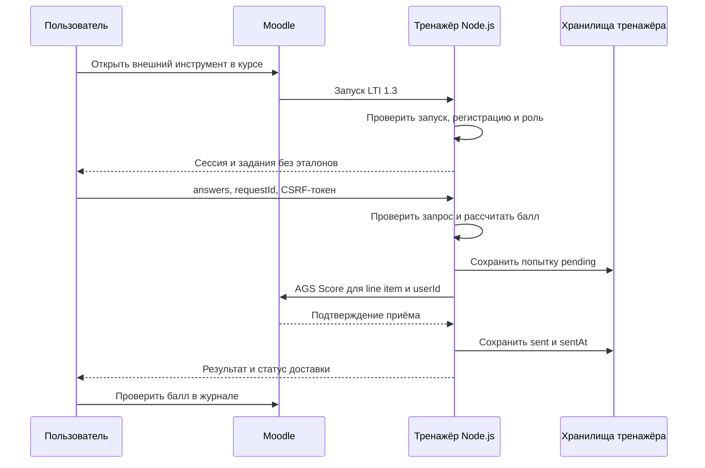

# Отчёт: внешний тренажёр из трёх заданий с Moodle LTI 1.3

Автор: заполнить ФИО и группу перед сдачей.

Дата подготовки: 11.10.2026. Основание: `docs/Moodle_LTI_Three_Tasks_Lab.pdf`, раздел 16, страница 17.

## Цель и реализованный вариант

Разработан вариант внешнего тренажёра по основам HTML на предоставленном Node.js-каркасе. Приложение получает пользователя и контекст из проверенного запуска Moodle, принимает ответы, рассчитывает итог на сервере и реализует передачу через Assignment and Grade Services в существующую колонку журнала.

Развёртывание выполнено в GitHub Codespaces: Node.js обслуживает порт 3000, MongoDB запускается Docker Compose на 27017. Публичный HTTPS-доступ предоставляется прокси Codespaces только для 3000. Проект: https://github.com/L1oneSs/lti-lab. LTI-запуск преподавателя подтверждён предоставленным пользователем скриншотом. Реальная передача оценок студентов пока не подтверждена.

## Собственные задания и расчёт

| ID | Формулировка | Допустимый ответ | Вес |
|---|---|---|---|
| q1 | Какой HTML-тег создаёт гиперссылку при наличии атрибута href? | a | 3 |
| q2 | Какой HTML-тег вставляет изображение через атрибут src? | img | 3 |
| q3 | Какой HTML-тег обозначает нумерованный список? | ol | 4 |

Вводится имя тега без угловых скобок и атрибутов. Сервер удаляет крайние пробелы и приводит строку к нижнему регистру. ` IMG ` принимается, `` и `img src` не принимаются. Пустая или неверная строка даёт 0 баллов за вопрос. Итог — сумма баллов верных ответов, максимум 10.

Данные должны содержать ровно три ключа `q1`, `q2`, `q3`; значение каждого — строка до 200 символов. Массив вместо объекта или строки, лишний ключ, отсутствующий ответ и превышение длины приводят к HTTP 400 без отправки оценки. Правильные ответы находятся в `src/grading.mjs`, а браузеру выдаются только ID, формулировки и веса.

## Схема взаимодействия

Текстовая схема: Moodle → проверенный LTI-запуск → серверная сессия → ответы → серверный расчёт → сохранение попытки → AGS → существующая колонка журнала.

## Идентичность, роли и защита

Источник идентичности — `context.idToken.user.id`. Приложение сверяет платформу, Client ID и Deployment ID, а история отделяется по платформе, регистрации, пользователю, курсу и ресурсу. Поля `userId` и `scoreGiven` в JSON отправки запрещены. Браузер не задаёт получателя оценки или балл.

Запросы требуют действительной серверной сессии. Для POST дополнительно проверяются наличие роли Learner, Origin и CSRF-токен. Преподаватель в текущем запуске имеет режим просмотра: поля и отправка отключены. Line item определяет колонку журнала, а userId в сообщении Score — студента. Новая колонка программно не создаётся.

## Попытки и повтор доставки

До вызова AGS ответы и серверный результат сохраняются в `data` со статусом `pending`. При неподтверждённой доставке разрешён повтор с тем же `requestId` и ответами; создание следующей попытки блокируется. После подтверждения сохраняются `sent` и `sentAt`. Повтор уже подтверждённого текущего запроса возвращает сохранённый результат без нового вызова AGS.

«Новая попытка» переносит завершённую текущую попытку в историю и разрешает новые ответы. Последняя завершённая попытка заменяет прежнюю оценку, даже если балл ниже. При неоднозначном сбое Moodle мог принять оценку до потери ответа: exactly-once не гарантируется. Для каждой доставки сервер сохраняет строго возрастающий timestamp.

MongoDB хранит регистрацию, ключи и сведения библиотеки LTI. Папка `data` хранит историю и текущие попытки; память процесса — сессии на 45 минут и одноразовые билеты. После перезапуска Node.js требуется повторно открыть элемент Moodle; история и ключи сохраняются при сохранённых папке и базе. Приложение рассчитано на один процесс Node.js. LRS и xAPI не используются.

## Автоматическая проверка

11.10.2026 выполнен `npm test` под Node.js v24.21.0 на Windows. Фактический вывод сохранён в `evidence/npm-test.txt`: **7 тестов, 7 pass, 0 fail**.

Тесты выполнены в локальном каталоге `moodle-lti-three-tasks-lab`, где установлены зависимости. Перед запуском хеши файлов `src`, `public` и `test` сопоставлены с каталогом репозитория `lti-lab`; различий не обнаружено. Это локальная проверка того же кода, а не результат запуска тестов внутри Codespaces.

| Вид проверки | Содержание |
|---|---|
| Три исходных теста расчёта | Нормализация, нулевой/частичный/максимальный итог, некорректный ввод |
| Три собственных дополнительных теста | Регистр и пробелы HTML; запрет скобок и атрибутов; различение ol и ul |
| Интеграционный тест с имитацией | Подписанный запуск, AGS, изоляция А/Б, роли, подмена пользователя, CSRF, replay, повтор и восстановление доставки |

Строка `AGS не подтвердил оценку: HttpError` ожидаема: интеграционный тест специально имитирует сбой сервиса. Этот тест не требует настоящего Moodle или MongoDB и не доказывает запись оценки на действующем стенде.

## Проверка настоящего Moodle и ограничения готовности

Подтверждены публичный ответ `/healthz` и экран тренажёра, открытого из Moodle под преподавателем: курс 66, ресурс 4, режим просмотра. Скриншот находится в переписке; отдельный файл доказательства ещё требуется добавить.

Не подтверждены реальные оценки студентов А/Б, повтор доставки на действующем стенде и отрицательные HTTP-запросы. Таблица с ожидаемыми результатами и местами для фактических значений находится в `CHECKS.md`. Пока строки не заполнены по наблюдениям и не приложены снимки журнала, работа не имеет полного комплекта доказательств для сдачи.

Инструкции воспроизведения: `../CODESPACES.md`. Ответы на все шесть вопросов защиты и план индивидуального изменения правила: `../DEFENSE.md`. Codespace и процесс приложения должны оставаться запущенными во время проверки.
